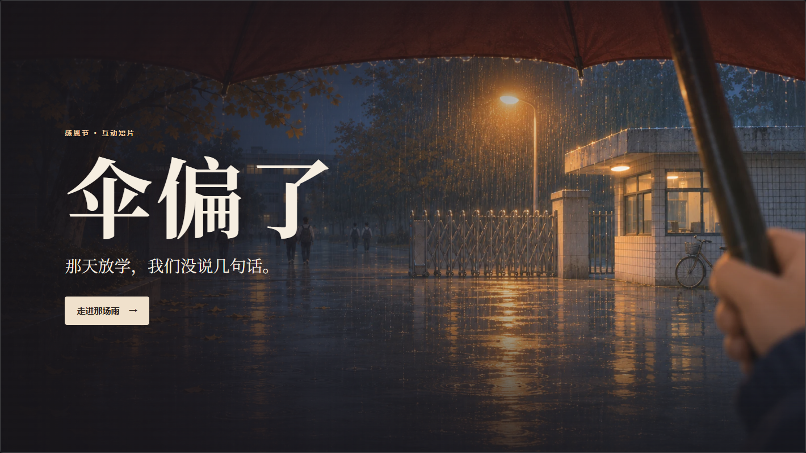

# 《伞偏了》

感恩节 · AI 创意单人设计赛 · 实时 3D 互动短片 · 约 2 分钟

## 作品简介

午休时，「我」没等同桌把话说完，悄悄把椅子往窗边挪了半步。放学下雨，同桌还是递了伞过来。观众可以从伞下转到两人背后，这时才看到同桌肩头的湿痕。再往同桌那边靠半步，伞便重新遮住两个人。第二天清早，观众把椅子拉回桌前，那道题也终于有机会说完。

## 打开与体验

在 GitHub 点击 **Code → Download ZIP**，解压后双击 `index.html`，用电脑的 Chrome 或 Edge 打开。画面、音频和程序随单文件内嵌。打开声音能听到雨落在伞布上、脚踩过积水和椅脚擦过地面。可暂停、手动快进或用 `M` 切换静音。

雨中一幕，向右拖动下方的滑杆，或者选「换个角度」。到两人背后，可以「看近一点」，然后选「往你那边靠半步」。如果想进一步看看雨和伞之间的关系，进入「试试怎么撑」，分别调整两人的距离和伞的方向。页面会提示哪边还在淋雨，也可以帮两人找一个同在伞下的站位。回到影片，走完第二天的教室，最后可以把自己的感谢写在便笺上，复制文字或保存为 PNG。

用于雨中一幕的 3D 建模和渲染代码见 [src/rain-scene.js](src/rain-scene.js)，作品运行所需的版本已打包进 HTML。

如浏览器无法使用 WebGL，雨中一幕会以插画呈现，仍可切换视角并完成故事。站位体验需要 WebGL。

## AI 在制作中做了什么

- 作者提出感恩节主题、选择用同一场雨的两个视角讲故事，并根据成稿反馈确定三幕结构与实时 3D 的呈现方向。
- 使用 Codex 协作打磨剧本、安排镜头与声音，编写程序化建模、灯光、镜头控制、动态雨幕和离线交互。开场及教室采用 AI 生成的分镜插画，统一了场景、服装和道具。雨中体验的角色、伞、校门、路灯与雨使用代码建模和实时渲染。
- 观众移动伞或调整站位时，程序从两人的肩部向上检测射线是否撞到伞面。自动站位遍历一组候选位置，选取能护住两人且离当前设置较近的组合。放映时这部分在浏览器内计算。

## 参赛介绍

> 那天我和同桌闹了点别扭，放学却还是共撑了一把伞。看这部短片时，你先站在伞下，再自己绕到两个人背后。有一个细节，换个角度才看得见。然后，轮到你决定要不要往他身边靠半步。

## 素材与署名

- 雨声为 Fiver, der Hellseher 的《Heavy Rain in Summer》。本片沿用第一版剪裁和均衡后的循环，原始素材与此改编音频均采用 CC BY-SA 3.0。[原始音频](https://commons.wikimedia.org/wiki/File:Heavy_Rain_in_Summer.ogg) · [许可](https://creativecommons.org/licenses/by-sa/3.0/)
- 自行车铃为 Madvedj 的《Bicycle Bell》，本片沿用第一版截取并处理的一声车铃，许可为 CC0 1.0。[素材与许可](https://creazilla.com/media/audio/15442048/bicycle-bell)
- 脚步、雨滴击打伞布和椅脚声由程序合成。实时渲染使用 Three.js，内嵌文件包含 MIT 许可及版权声明。[Three.js](https://threejs.org/)
